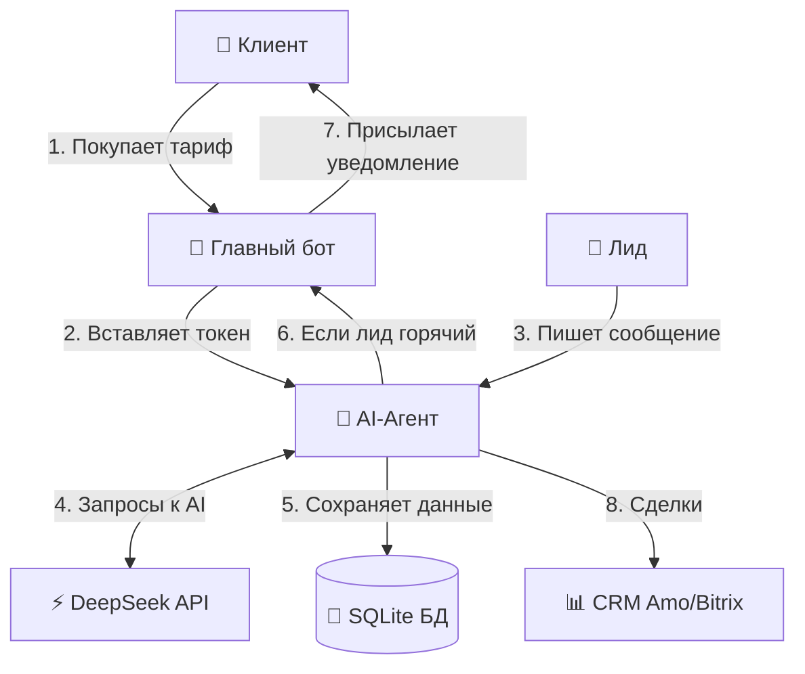
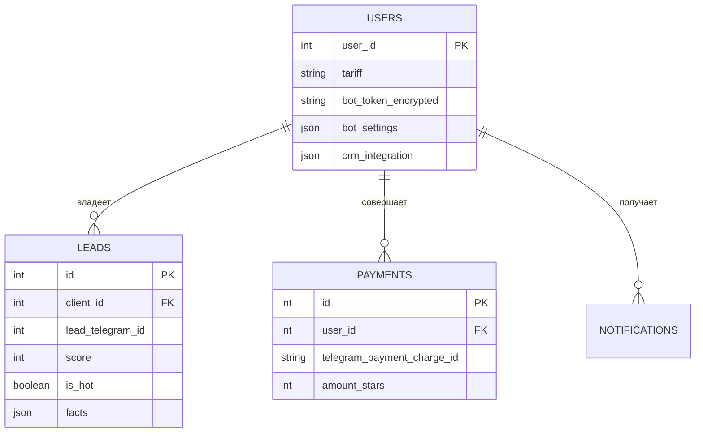
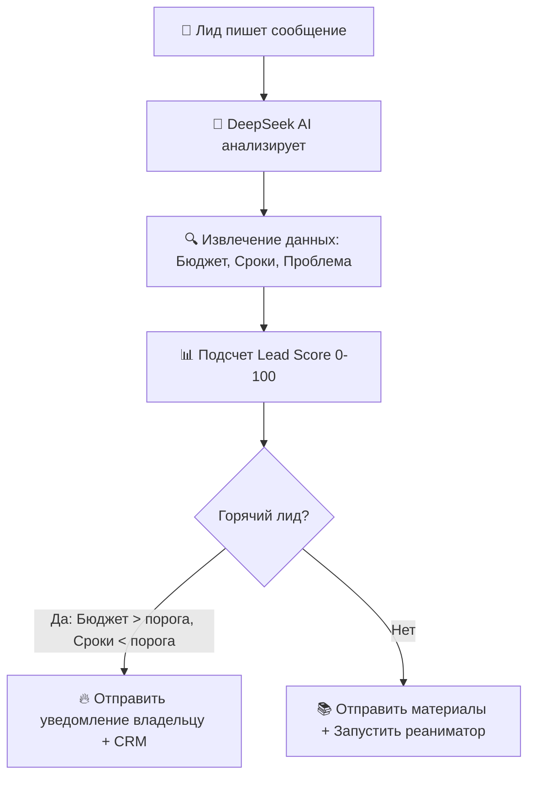
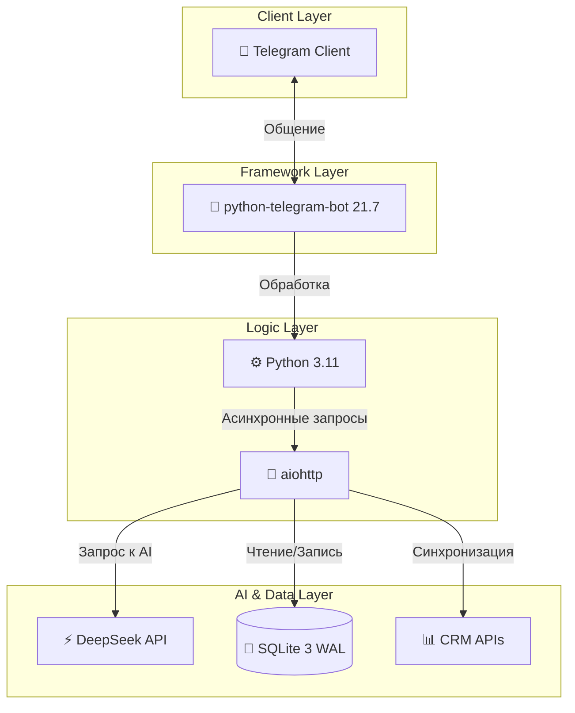

# 🤖 AI Manager

### SaaS-платформа для автоматизации продаж и квалификации лидов в Telegram

**Продавай AI-менеджеров. Автоматизируй бизнес. Зарабатывай на подписках.**

---

## 📖 О проекте

**AI Manager** — это готовая коммерческая SaaS-платформа, которая позволяет предпринимателям запускать собственных AI-менеджеров по продажам в Telegram за 5 минут. 

Владелец бизнеса покупает подписку, подключает своего бота, и нейросеть начинает общаться с его клиентами 24/7, отсеивая «мусор» и передавая только «горячих» лидов с бюджетом и сроками прямо в чат владельцу.

---

## 🏗️ Архитектура системы

Проект спроектирован по принципу **микросервисной архитектуры**. Каждый клиент получает изолированный процесс агента, чтобы падение одного бота не ломало работу всей платформы.

- **Главный бот (`bot_main.py`)** — точка входа. Продажи, оплата (Telegram Stars), активация агентов, настройки.
- **AI-Агент (`bot_agent.py`)** — отдельный процесс для каждого клиента. Общение с лидами через DeepSeek AI, фильтрация, RAG-поиск.
- **Админ-бот (`bot_admin.py`)** — панель владельца платформы. Управление клиентами, платежами, мониторинг упавших агентов.
- **База данных** — SQLite с WAL-режимом для параллельной записи из всех процессов.

### 🛠️ Как это работает (Бизнес-поток)

1. **Продажа:** Клиент заходит в Главный бот, выбирает тариф и оплачивает его.
2. **Активация:** Клиент создает бота у `@BotFather` и отправляет токен в Главный бот.
3. **Запуск:** Главный бот валидирует токен и запускает `bot_agent.py` как отдельный процесс.
4. **Общение:** AI-Агент общается с лидами, использует базу знаний и считает `Lead Score` (от 0 до 100).
5. **Уведомление:** Если лид набрал нужный балл (горячий), агент кладет уведомление в БД, а Главный бот присылает его владельцу.

---

## ✨ Ключевые возможности

### 🎯 Для клиента (Владельца бизнеса)
- 💳 **Оплата:** Интеграция с Telegram Stars и ручной перевод на карту.
- ⚙️ **Конструктор:** Настройка скрипта продаж, товаров, FAQ и базы знаний (RAG).
- 🎯 **Фильтрация лидов:** Настройка порогов (например, «бюджет от 50к И сроки до 7 дней»).
- 🕐 **Расписание:** Бот молчит в нерабочие часы.
- 📊 **Аналитика:** Еженедельные отчеты с графиками динамики лидов (Matplotlib).
- 🅰️🅱️ **A/B Тестирование:** Проверка двух вариантов приветствия (для Pro-тарифа).
- 📁 **Экспорт:** Генерация реальных отчетов в Excel (`.xlsx`), PDF и CSV.
- 📈 **CRM-интеграция:** Автоматическая отправка лидов в AmoCRM, Bitrix24 или HubSpot.
- 🎤 **Мультиязычность:** Автоопределение языка лида (русский, английский, испанский, арабский, китайский).

### 🤖 Для AI-Агента
- 💬 **DeepSeek AI** для свободного и естественного диалога.
- 📚 **RAG и FAQ** для точных ответов по документам клиента.
- 📊 **Lead Scoring:** Оценка лида, парсинг бюджета и сроков (Regex + AI).
- 🔄 **Fallback-режим:** Работает даже без нейросети (жесткий скрипт из 3 вопросов).
- ⏰ **Реаниматор:** 3 попытки follow-up для «остывших» лидов (через 1ч / 24ч / 72ч).

### 👑 Для Админа (Владельца платформы)
- 📋 Управление клиентами, тарифами и скидками.
- 💰 Статистика по выручке в Telegram Stars.
- 🚦 **Health-check:** Авто-проверка агентов. Если агент упал — админ-бот перезапустит его сам или пришлет алерт.

---

## 🛠️ Стек технологий

| Слой | Технология | Зачем используется |
| :--- | :--- | :--- |
| **Язык** | Python 3.11+ | Асинхронность и богатая экосистема |
| **Telegram** | `python-telegram-bot` 21.7 | `JobQueue` для фоновых задач, работа с платежами |
| **AI** | DeepSeek API | В 5-10 раз дешевле OpenAI, отличный русский язык |
| **БД** | SQLite 3 (WAL) | Параллельная запись из нескольких процессов без сервера |
| **Безопасность** | `cryptography` (AES-256-GCM) | Шифрование токенов клиентов |
| **Графика** | `matplotlib` | Генерация графиков для отчетов |
| **Документы** | `openpyxl`, `reportlab` | Генерация Excel и PDF-файлов |
| **HTTP** | `aiohttp` | Асинхронные запросы к AI, CRM и Google Sheets |

---

## 🧪 Тестирование

В проекте написан комплексный скрипт `selftest.py`, который проверяет всё ядро приложения без подключения к Telegram.

* **50 тестов:** шифрование, CRUD базы данных, парсинг текста, генерация графиков и документов.
* **Результат:** 50/50 (Все тесты пройдены успешно).
* **Артефакты:** Скрипт создает реальные файлы (PDF, Excel, PNG) в папке `selftest_output/`.

---

## 🚀 Быстрый старт

**1. Установка зависимостей:**
Открой терминал и введи:
`git clone https://github.com/ooomaza/aiagent_bot.git`
`cd aiagent_bot`
`pip install -r requirements.txt`

**2. Настройка окружения:**
Создайте файл `.env` в корне проекта и вставьте туда свои ключи:
`MAIN_BOT_TOKEN=токен_главного_бота`
`ADMIN_BOT_TOKEN=токен_админ_бота`
`DEEPSEEK_API_KEY=ключ_deepseek`

**3. Запуск:**
Терминал 1: `python bot_main.py`
Терминал 2: `python bot_admin.py`
